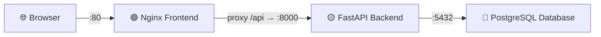

# 🚀 API Pulse — Docker Deployment & Operations Guide

> Complete reference for building, running, migrating, updating, and debugging the API Pulse Docker stack.

---

## Architecture Overview



| Service | Image | Port | Purpose |
|---------|-------|------|---------|
| `db` | `postgres:15-alpine` | 5432 (internal), 5433 (host) | PostgreSQL database |
| `backend` | Custom (your app) | 8000 (internal + host) | FastAPI + Alembic + APScheduler |
| `frontend` | `nginx:alpine` | 80 (public) | Serves HTML/CSS/JS + proxies `/api` to backend |

---

## Credential Security Setup

> [!IMPORTANT]
> `docker-compose.yml` is committed to Git. **NEVER hardcode passwords there.** Docker Compose automatically reads `.env` from the same directory and substitutes `${VAR}` placeholders.

### How It Works

```
Git Repo (safe to push)            Local Machine Only
─────────────────────              ──────────────────
docker-compose.yml                 .env  ← NOT in Git
  POSTGRES_PASSWORD: ${POSTGRES_PWD}  ←──  POSTGRES_PASSWORD=MySecret
                                        SECRET_KEY=abc123...
.env.example (dummy placeholders)      SMTP_PASSWORD=gmail_pass
.gitignore   (lists .env, .env.*)
```

### Which Files Are Safe to Commit?

| File | Committed to Git? | Purpose |
|------|:-----------------:|---------|
| [`docker-compose.yml`](file:///D:/MonitoringEngine/docker-compose.yml) | ✅ Yes | References `${VARS}` — no real secrets |
| [`.env`](file:///D:/MonitoringEngine/.env) | ❌ No (gitignored) | Your real passwords and keys |
| [`.env.example`](file:///D:/MonitoringEngine/.env.example) | ✅ Yes | Template with dummy values for collaborators |
| [`.gitignore`](file:///D:/MonitoringEngine/.gitignore) | ✅ Yes | Contains `.env` and `.env.*` rules |

### Setting Up Credentials (First Time / New Machine)

```powershell
# 1. Copy the template
cp .env.example .env

# 2. Open .env and fill in your actual passwords
notepad .env
```

Required values to fill in `.env`:

```ini
POSTGRES_PASSWORD=choose_a_strong_password
SECRET_KEY=run_python_below_to_generate
ENCRYPTION_KEY=run_python_below_to_generate
SMTP_PASSWORD=your_gmail_app_password
```

```powershell
# Generate SECRET_KEY
python -c "import secrets; print(secrets.token_hex(32))"

# Generate ENCRYPTION_KEY
python -c "from cryptography.fernet import Fernet; print(Fernet.generate_key().decode())"
```

---

## Part 1 — First-Time Setup

### Step 1: Prerequisites

> [!IMPORTANT]
> Docker Desktop must be installed and **running** before any docker commands work.
> Download: https://www.docker.com/products/docker-desktop/

```powershell
# Verify Docker is working
docker --version
docker compose version
```

### Step 2: Prepare `.env`

```powershell
cd D:\MonitoringEngine
cp .env.example .env
# Fill in POSTGRES_PASSWORD, SECRET_KEY, ENCRYPTION_KEY, SMTP_PASSWORD
notepad .env
```

### Step 3: Build and Start Everything

```powershell
# First time — builds image + starts all containers in foreground
docker compose up --build
```

**What happens automatically:**
1. Pulls `postgres:15-alpine` and `nginx:alpine` images from Docker Hub
2. Builds your custom backend image from `Dockerfile`
3. Starts PostgreSQL and waits for healthcheck to pass
4. Backend runs `alembic upgrade head` (applies all migrations)
5. Backend starts Uvicorn on port 8000
6. Nginx starts serving frontend on port 80

**Expected success logs:**

```
db-1       | database system is ready to accept connections
backend-1  | INFO  [alembic.runtime.migration] Running upgrade -> abc123...
backend-1  | INFO:     Uvicorn running on http://0.0.0.0:8000
frontend-1 | ... start worker process ...
```

### Step 4: Verify It Works

| What | URL | Expected Result |
|------|-----|-----------------|
| Frontend | http://localhost | Login page loads |
| Swagger Docs | http://localhost/docs | Swagger UI |
| Backend direct | http://localhost:8000/docs | Swagger UI |
| Health check | http://localhost:8000/ | `{"message": "...running!"}` |

---

## Part 2 — Daily Workflow Commands

### Starting & Stopping

```powershell
# Start in foreground (see live logs)
docker compose up

# Start in background (detached — runs silently)
docker compose up -d

# Start and rebuild images (use after code changes)
docker compose up --build

# Start in background AND rebuild
docker compose up --build -d

# Stop all containers (keeps data volume)
docker compose down

# Stop + remove database volume — ALL DB DATA DELETED
docker compose down -v
```

### Viewing Logs

```powershell
# Follow logs from all services
docker compose logs -f

# Follow logs from only the backend
docker compose logs -f backend

# Follow logs from only the database
docker compose logs -f db

# Follow logs from only nginx
docker compose logs -f frontend

# Show last 100 lines of backend logs (no follow)
docker compose logs --tail=100 backend

# Show logs with timestamps
docker compose logs -f --timestamps backend
```

### Checking Status

```powershell
# See which containers are running (health, ports, etc.)
docker compose ps

# See all containers including stopped ones
docker compose ps -a

# See resource usage (CPU, memory)
docker stats
```

---

## Part 3 — Database Migrations (Alembic)

> [!NOTE]
> Alembic migrations run **automatically** when the backend container starts (`alembic upgrade head` is in the Dockerfile CMD). Manual commands below are for development use.

### Run Migrations Manually Inside the Container

```powershell
# Apply all pending migrations (upgrade to latest)
docker compose exec backend alembic upgrade head

# Check current migration version
docker compose exec backend alembic current

# Show full migration history
docker compose exec backend alembic history --verbose

# Show pending (unapplied) migrations
docker compose exec backend alembic history -r current:head
```

### Create a New Migration

```powershell
# Auto-generate migration from SQLAlchemy model changes
docker compose exec backend alembic revision --autogenerate -m "add_new_table"

# Create empty migration file (manual SQL)
docker compose exec backend alembic revision -m "manual_data_fix"
```

> [!TIP]
> After generating a migration, check the file in `alembic/versions/` — auto-generated migrations sometimes miss indexes or constraints. Always review before applying.

### Rollback Migrations

```powershell
# Rollback one step
docker compose exec backend alembic downgrade -1

# Rollback to a specific revision (get ID from alembic history)
docker compose exec backend alembic downgrade abc123def456

# Rollback all the way to empty database
docker compose exec backend alembic downgrade base
```

### Running Migrations Locally (Without Docker)

```powershell
# From project root, with local .env loaded
cd D:\MonitoringEngine
.venv\Scripts\Activate.ps1
alembic upgrade head
```

---

## Part 4 — Updating Your Code

### Scenario A: Python Code Changed (No New Dependencies)

```powershell
# Rebuild the backend image and restart it
docker compose up --build -d

# OR just restart without rebuild (if image is already built with latest changes)
docker compose restart backend
```

### Scenario B: New Python Dependency Added to `requirements.txt`

```powershell
# Must rebuild — pip install runs during Docker build stage
docker compose up --build -d
```

### Scenario C: New Database Migration Added

```powershell
# Rebuild triggers auto-migration on startup (alembic upgrade head in CMD)
docker compose up --build -d

# Confirm migration ran
docker compose exec backend alembic current
docker compose logs --tail=50 backend | Select-String "alembic"
```

### Scenario D: Frontend HTML/CSS/JS Changed

```powershell
# No rebuild needed — frontend is a volume mount, Nginx reads live files
# Just clear your browser cache or force-refresh with Ctrl+Shift+R
```

### Scenario E: `nginx.conf` Changed

```powershell
# Restart only the nginx container — no rebuild needed
docker compose restart frontend

# OR reload nginx config without any downtime
docker compose exec frontend nginx -s reload
```

### Scenario F: Environment Variables (`.env`) Changed

```powershell
# Containers must be fully recreated to pick up new env vars
docker compose down
docker compose up -d
```

### Scenario G: Changed `POSTGRES_PASSWORD` in `.env`

> [!CAUTION]
> PostgreSQL only reads its password during the **first initialization** of the data volume. If you change the password after the volume already exists, Postgres keeps using the old one and the backend fails to connect.

```powershell
# Must destroy the volume and reinitialize the database
docker compose down -v          # DELETES all database data
docker compose up --build -d    # Starts fresh with new password
```

---

## Part 5 — Shell Access & Debugging

### Shell Into a Running Container

```powershell
# Open a shell inside the backend container
docker compose exec backend sh

# Open a shell inside the database container
docker compose exec db sh

# Open a shell inside the frontend (nginx) container
docker compose exec frontend sh
```

### Direct PostgreSQL Access

```powershell
# Connect to psql inside the db container
docker compose exec db psql -U postgres -d monitoring_db

# List all tables
docker compose exec db psql -U postgres -d monitoring_db -c "\dt"

# Run a raw SQL query
docker compose exec db psql -U postgres -d monitoring_db -c "SELECT * FROM users LIMIT 5;"

# Connect from host machine (uses port 5433 exposed on host)
psql -h localhost -p 5433 -U postgres -d monitoring_db
```

### Inspect Environment Variables in Backend

```powershell
# Confirm which env vars the running backend sees
docker compose exec backend env | Sort-Object

# Check that DATABASE_URL points to @db (not @localhost)
docker compose exec backend env | Select-String "DATABASE_URL"
```

### Check If `.env` Is Loading Correctly

```powershell
# Preview what docker compose resolves all ${VARS} to
docker compose config
```

---

## Part 6 — Image & Volume Management

### Rebuilding from Scratch

```powershell
# Force rebuild ignoring all Docker layer caches
docker compose build --no-cache

# Then start
docker compose up -d
```

### Cleaning Up Disk Space

```powershell
# Remove stopped containers, unused networks, dangling images
docker system prune

# Also remove unused volumes (careful — may delete other project data)
docker system prune --volumes

# Just remove dangling images
docker image prune

# List all Docker volumes
docker volume ls

# Remove the postgres volume by name
docker volume rm monitoringengine_postgres_data
```

### View Docker Images

```powershell
# List all local images
docker images

# See image size and layer history
docker history monitoringengine-backend
```

---

## Part 7 — Production Tips

### Run Silently in Background (Server / VPS)

```powershell
# Start all services detached
docker compose up --build -d

# Check they are all healthy
docker compose ps

# Follow logs anytime
docker compose logs -f
```

### Restart Policy

All services in our `docker-compose.yml` use `restart: unless-stopped`:
- Containers restart automatically after a crash ✅
- Containers restart after host machine reboot ✅
- Containers do NOT restart if you manually `docker compose down` ✅

### Environment-Specific Config

For staging vs production, use `--env-file` flag:

```powershell
# Use staging credentials
docker compose --env-file .env.staging up -d

# Use production credentials
docker compose --env-file .env.production up -d
```

---

## Part 8 — Quick Reference Cheat Sheet

```powershell
# ── STARTUP ─────────────────────────────────────────────────────────
docker compose up --build          # Build + start (foreground)
docker compose up --build -d       # Build + start (background)
docker compose up -d               # Start using existing build (background)

# ── SHUTDOWN ─────────────────────────────────────────────────────────
docker compose down                # Stop and keep DB data
docker compose down -v             # Stop and WIPE database volume

# ── LOGS ─────────────────────────────────────────────────────────────
docker compose logs -f             # All services live logs
docker compose logs -f backend     # Backend only
docker compose logs -f db          # Database only
docker compose logs --tail=100 backend   # Last 100 lines

# ── STATUS ───────────────────────────────────────────────────────────
docker compose ps                  # Running containers + health
docker stats                       # CPU and memory usage

# ── RESTART ──────────────────────────────────────────────────────────
docker compose restart backend     # Restart backend only
docker compose restart frontend    # Restart nginx only
docker compose restart             # Restart all services

# ── MIGRATIONS ───────────────────────────────────────────────────────
docker compose exec backend alembic upgrade head          # Apply all pending
docker compose exec backend alembic current               # Current version
docker compose exec backend alembic history               # All revisions list
docker compose exec backend alembic downgrade -1          # Rollback one step
docker compose exec backend alembic revision --autogenerate -m "name"

# ── DATABASE ACCESS ───────────────────────────────────────────────────
docker compose exec db psql -U postgres -d monitoring_db        # psql prompt
docker compose exec db psql -U postgres -d monitoring_db -c "\dt" # List tables

# ── SHELL INTO CONTAINERS ─────────────────────────────────────────────
docker compose exec backend sh     # Backend shell
docker compose exec db sh          # Database shell
docker compose exec frontend sh    # Nginx shell

# ── DEBUGGING ─────────────────────────────────────────────────────────
docker compose config              # Preview resolved compose + all env vars
docker compose exec backend env | Select-String "DATABASE_URL"

# ── CLEANUP ───────────────────────────────────────────────────────────
docker system prune                # Remove unused containers and images
docker compose build --no-cache    # Force full rebuild from scratch
docker volume ls                   # List all Docker volumes
```

---

## Part 9 — Troubleshooting

### Backend fails with `connection refused` to database

Postgres isn't ready yet. The `healthcheck` + `depends_on: condition: service_healthy` handles this automatically. Check DB logs:

```powershell
docker compose logs db
```

### Backend fails with `password authentication failed`

`POSTGRES_PASSWORD` in `.env` doesn't match what was used to initialize the volume:

```powershell
docker compose down -v
docker compose up --build -d
```

### Port 80 already in use (IIS or other web server)

Change the frontend port in `docker-compose.yml`:

```yaml
ports:
  - "3000:80"   # Now access at http://localhost:3000
```

### Port 8000 already in use

Find and stop the conflicting process:

```powershell
netstat -ano | findstr :8000
# Then kill by PID: taskkill /PID <pid> /F
```

### `Directory 'frontend' does not exist` error in backend

The backend container doesn't have `frontend/` (excluded in `.dockerignore`). This is already handled in [`app/main.py`](file:///D:/MonitoringEngine/app/main.py) by conditionally mounting StaticFiles only if the directory exists.

### Migrations fail on startup

Check if Alembic version files are being copied into the image:

```powershell
docker compose exec backend ls alembic/versions/
docker compose logs backend | Select-String "alembic"
```

### Environment variable is empty inside container

Verify docker compose resolves it correctly:

```powershell
docker compose config | Select-String "POSTGRES_PASSWORD"
```

If it shows empty, your `.env` file is missing that variable. Open it and add it.

---

## Files — Complete Reference

| File | Git | Purpose |
|------|:---:|---------|
| [`Dockerfile`](file:///D:/MonitoringEngine/Dockerfile) | ✅ | Builds Python backend image |
| [`docker-compose.yml`](file:///D:/MonitoringEngine/docker-compose.yml) | ✅ | Orchestrates all 3 services, uses `${VARS}` |
| [`nginx.conf`](file:///D:/MonitoringEngine/nginx.conf) | ✅ | Nginx — serves frontend + proxies `/api` |
| [`.dockerignore`](file:///D:/MonitoringEngine/.dockerignore) | ✅ | Excludes `.venv`, `.env`, `frontend/` from image |
| [`.env.example`](file:///D:/MonitoringEngine/.env.example) | ✅ | Template with dummy values for collaborators |
| [`.env`](file:///D:/MonitoringEngine/.env) | ❌ | Your real secrets — never commit this |
| [`.env.docker`](file:///D:/MonitoringEngine/.env.docker) | ❌ | Old docker env file — superseded by `.env` |
| [`.gitignore`](file:///D:/MonitoringEngine/.gitignore) | ✅ | Ignores `.env`, `.env.*` patterns |
